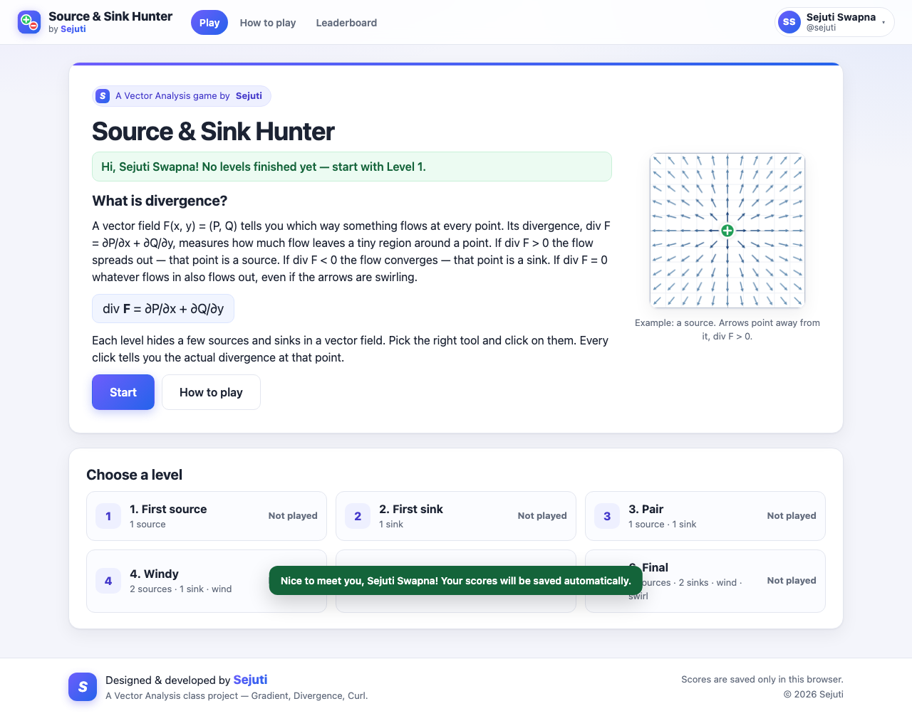
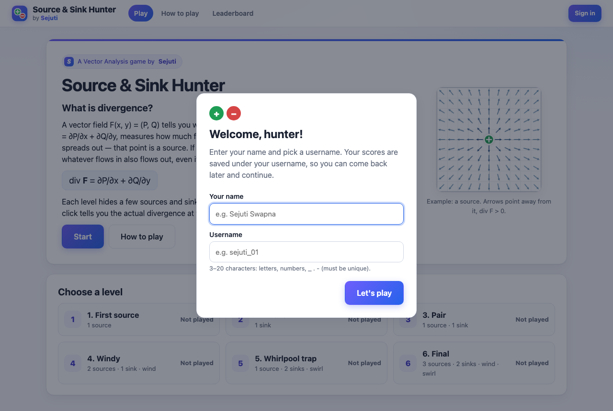
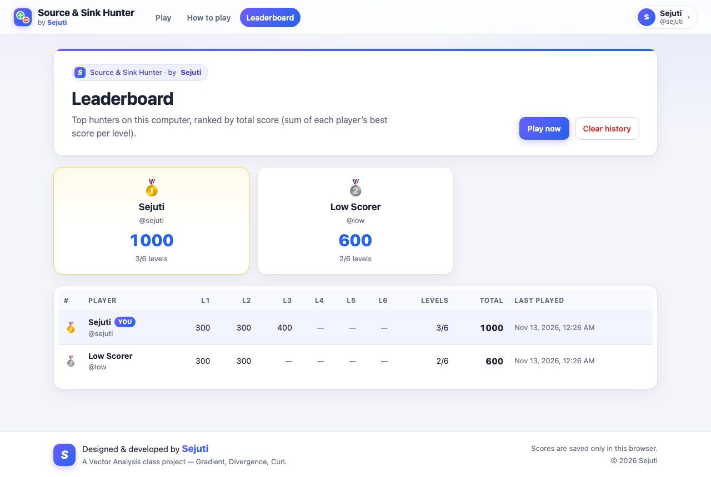
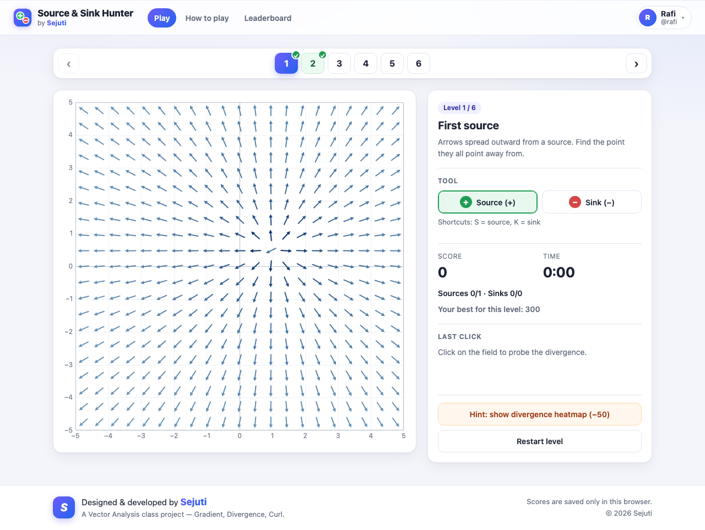
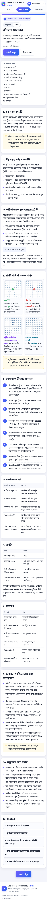
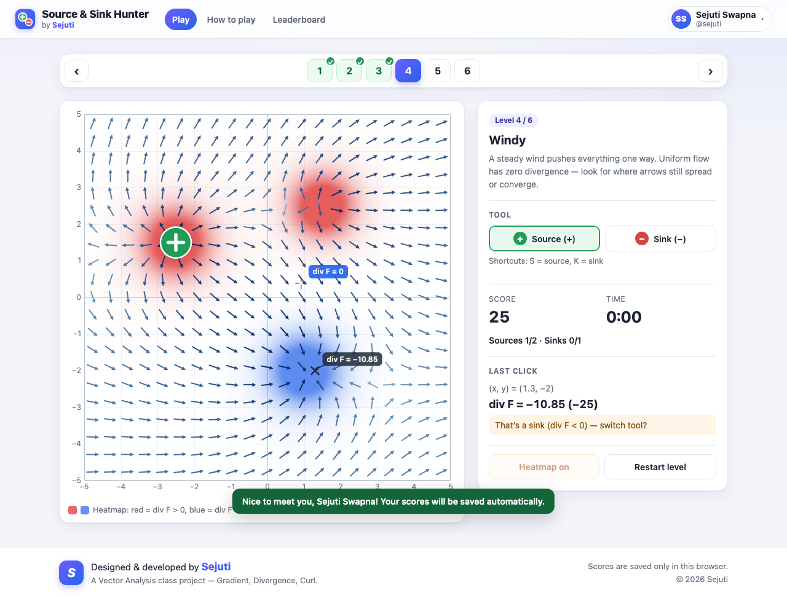
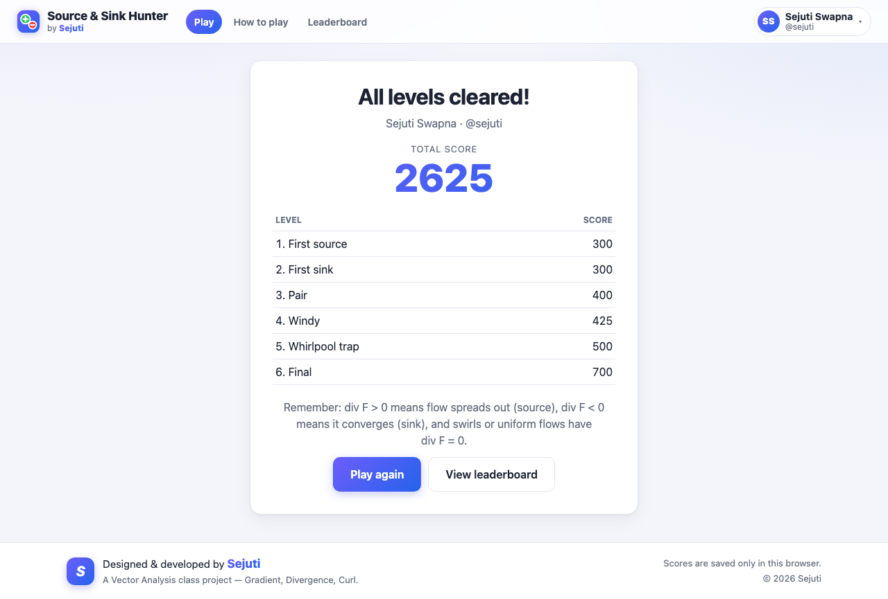
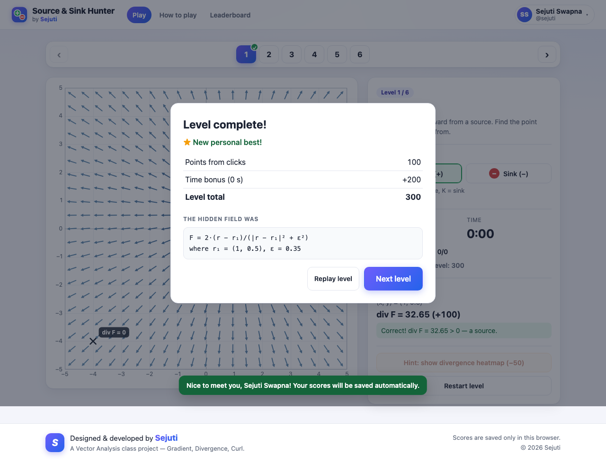
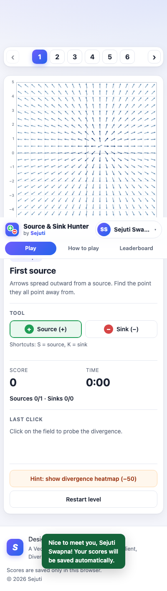

# Source & Sink Hunter — a Divergence Game

**Designed & developed by Sejuti** · a Vector Analysis class project

A small browser game for Vector Analysis (Schaum's Outline, Chapter 4: Gradient, Divergence, Curl).
You see a 2D vector field **F**(x, y) = (P, Q) drawn as arrows, and you have to find its hidden
**sources** (div **F** > 0, flow spreads out) and **sinks** (div **F** < 0, flow converges) by clicking on them.
Every click shows the actual divergence at that point, so you learn what divergence looks like.
Some levels add a uniform "wind" or a whirlpool. Both have zero divergence: they look busy, but they are not sources or sinks.



## How to run

ES modules do **not** load from `file://`, so double-clicking `index.html` will not work. Serve the folder from a local web server:

```bash
npm install      # one time
npm start        # serves on http://localhost:8080
```

Then open **http://localhost:8080**.

No Node? From this folder, run:

```bash
python3 -m http.server 8080
```

and open http://localhost:8080. Once it is served, the game works offline. It uses no CDN and no build step.

### How to play

- Choose the **Source (+)** or **Sink (−)** tool. You can also press **S** or **K**.
- Click where you think a source or sink is. A click within 0.6 units of an unfound target of the right type counts as a hit.
- Hit: **+100**. Miss: **−25** (the score never goes below 0). Each miss shows a marker with div **F** at that spot and a verdict.
- **Hint** shows the divergence heatmap (red > 0, blue < 0) and a live div **F** readout under the cursor. It costs 50 points, once per level.
- Time bonus when you finish a level: `max(0, 200 − 2 × seconds)`.

## Build & deploy (Netlify)

There is no bundler. `npm run build` (`scripts/build.mjs`, plain Node, no dependencies) does three things:

1. Copies only the website files into a clean **`dist/`** folder: `index.html`, `404.html`, `style.css`, `favicon.svg`, `src/`, `instruction/`, `leaderboard/`, `_headers` and `_redirects`.
2. Checks that every local link, stylesheet, script and ES-module `import` resolves. A broken reference fails the build.
3. Writes `dist/build-info.json`, so you can open `/build-info.json` to see which version is live.

```bash
npm run build        # → dist/
npm run preview      # build + serve dist/ on http://localhost:8080
npm run test:dist    # build + run all E2E tests against dist/ (port 8081)
```

**Option A: connect the Git repo (recommended).** Push the `source-sink-hunter` folder to GitHub, GitLab or Bitbucket, then in Netlify choose *Add new site → Import an existing project*. `netlify.toml` already sets:

- build command `npm run build`
- publish directory `dist`
- Node 20
- `PLAYWRIGHT_SKIP_BROWSER_DOWNLOAD=1`, so the test browser isn't downloaded during the deploy

If the project is in a subfolder of the repo, set **Base directory** to `source-sink-hunter`.

**Option B: drag and drop.** Run `npm run build`, then drag the `dist/` folder onto <https://app.netlify.com/drop>.

**Option C: Netlify CLI.**

```bash
npx netlify-cli deploy --dir=dist          # draft URL
npx netlify-cli deploy --dir=dist --prod   # production
```

Notes:

- `_headers` adds security headers and makes browsers re-check JS and CSS after each deploy.
- `_redirects` adds short links: `/en`, `/bn`, `/how-to-play` and `/scores`.
- Unknown URLs show the branded `404.html`.
- Scores are stored in each visitor's own browser (localStorage + cookie). The deployed site has no server or database, so every visitor has their own leaderboard. The leaderboard is shared only between people using the same browser on the same device.

## Pages (routes)

| URL | What it is |
|---|---|
| `/` | The game: start screen, level select, levels, results |
| `/instruction/en` | Beginner's guide in English |
| `/instruction/bn` | The same guide in Bangla (বাংলা) |
| `/instruction` | Redirects to the language you used last (English by default) |
| `/leaderboard` | All players on this browser ranked by total score, with a **Clear history** button |

Every page has a language switch (English | বাংলা) on the guide, a header with navigation, and the current player's name in the top-right corner. Each route is a real folder with an `index.html`, so it works with any static server and needs no build step.

## Players and saved scores

The browser itself is the database. Nothing is sent over the network.

- **localStorage** (`ssh.db.v1`) holds every player and their per-level results: best score, last score, attempts, best time, whether the hint was used, and the last level played.
- **A cookie** (`ssh_player`, valid 1 year, `path=/`) remembers who is signed in, with a localStorage copy as a fallback if cookies are blocked.
- **First visit:** a popup asks for your **name** and a **username**. Usernames are unique and not case-sensitive: 3–20 letters, digits, `_ . -`.
- **Returning player:** if you type a username that already exists, the game asks "is that you?". If you confirm, it loads that player's saved history. If not, you choose another username.
- **Refreshing the page:** your best score per level, the level select (✓ and best score per level) and "Continue — Level N" all stay.
- **Level navigation:** the ‹ 1 2 3 4 5 6 › bar above the field lets you jump to any level at any time.
- **Start from new:** found on the start screen and in the menu under your name. It deletes only *your* scores.
- **Clear history:** on the leaderboard, it deletes every player and score. Whoever is signed in stays signed in, with an empty history.
- **Broken storage:** if the stored data is corrupted or storage is blocked, the game falls back to in-memory storage and does not crash.

## How to run the tests

```bash
npm test             # unit tests (Node's built-in test runner)
npx playwright install chromium   # one time, downloads the browser for E2E
npm run test:e2e     # Playwright smoke test (starts its own server on port 8080)
npm run test:all     # both
npm run test:dist    # build, then run the E2E tests against dist/
```

The E2E tests check that there are no console errors on any page. They cover the first-visit popup and its validation, playing all 6 levels through the `window.__game` hook, the heatmap hint, and scores surviving a page refresh. They also cover level navigation, a returning username loading its history, the unique-username prompt, Start from new, ranking on the leaderboard and Clear history, the `/instruction/en` ↔ `/instruction/bn` switch, and every page at 400 px. Screenshots are saved to `tests/e2e/screenshots/`.

## Math behind the game

**Divergence.** For **F** = (P, Q), div **F** = ∂P/∂x + ∂Q/∂y. It is the net outflow per unit area around a point:
positive at a source, negative at a sink, zero where whatever flows in also flows out.

**Softened point charge** at r₀ = (x₀, y₀) with strength q and ε = 0.35:

```
F = q (dx, dy) / d²,   dx = x − x₀,  dy = y − y₀,  d² = dx² + dy² + ε²
```

Derivation:

```
∂P/∂x = q (d² − 2dx²) / d⁴        ∂Q/∂y = q (d² − 2dy²) / d⁴
div F = q (2d² − 2dx² − 2dy²) / d⁴ = 2 q ε² / d⁴
```

This equals 2q/ε² at the charge and falls off quickly with distance. Its sign is the sign of q: a source if q > 0, a sink if q < 0.
Without ε, the field would be singular at the charge and its divergence would be a delta function. The softening lets us show a finite number there.

**Uniform flow** **F** = (u, v): both components are constant, so every derivative is 0 and div **F** = 0.

**Swirl** **F** = k (−(y − y_c), x − x_c) / (1 + |r − c|²):

```
∂P/∂x = k (y − y_c) · 2(x − x_c) / s²,   ∂Q/∂y = −k (x − x_c) · 2(y − y_c) / s²,   s = 1 + |r − c|²
div F = 0
```

The swirl rotates, so it has **curl**, but no divergence. That makes the whirlpool in level 5 a trap.

The game uses the analytic formulas above. `divergenceNumeric` (central differences) is used only by the unit tests, to check those formulas at 200 random points per level.

## Levels

| # | Title | Content |
|---|---|---|
| 1 | First source | 1 source (tutorial) |
| 2 | First sink | 1 sink |
| 3 | Pair | 1 source + 1 sink |
| 4 | Windy | 2 sources + 1 sink + uniform flow (0.6, 0.3) |
| 5 | Whirlpool trap | 1 source + 2 sinks + a swirl (k = 3) away from all charges |
| 6 | Final | 3 sources + 2 sinks + uniform flow + swirl, strengths 0.8 to 2.5 |

## Project structure

```
index.html, style.css
src/field.js    pure math: field evaluation, analytic + numeric divergence, formula string
src/levels.js   level data, target derivation
src/game.js     game state, scoring, hit detection (no DOM)
src/render.js   canvas drawing (grid, arrows, heatmap, markers)
src/strings.js  all UI text
src/storage.js  players + scores in localStorage, session cookie (testable in Node)
src/ui.js, src/layout.js, src/player-dialog.js   dialogs, toast, shared header/footer, name popup
src/main.js     game page: DOM wiring, screens, render loop, window.__game test hook
src/instructions.js + src/instruction-page.js    guide content (en, bn) + renderer
src/leaderboard-page.js
instruction/en/, instruction/bn/, instruction/, leaderboard/   route pages
tests/          unit tests (field, levels, game, storage) + tests/e2e/smoke.spec.js
```

## Screenshots

| First visit | Leaderboard |
|---|---|
|  |  |

| Level navigation | Bangla guide (phone) |
|---|---|
|  |  |

| Level 4 with heatmap hint | Final screen |
|---|---|
|  |  |

Level complete, with the hidden field revealed: 

Phone layout (400 px): 
